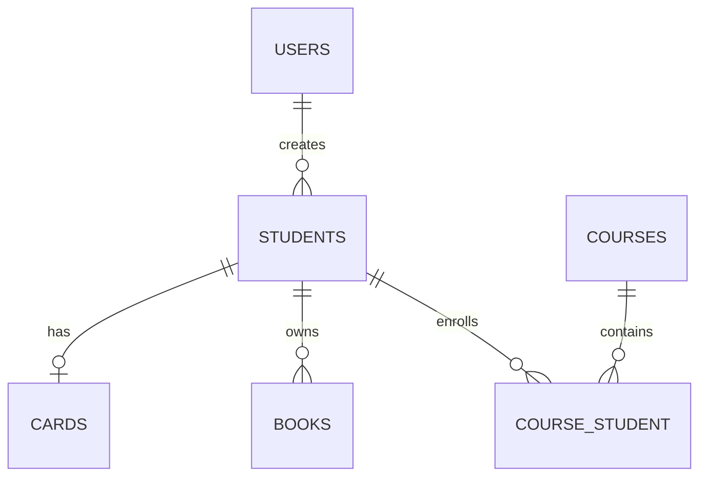

# المرجع الشامل — PHP وMySQL وLaravel

> **الإصدار 1.0.0 | تحديث 2026-10-31**  
> **هدفه:** تعرف شنو تعلمنا، ليش استخدمناه، شلون يشتغل الكود، شلون نختبره، وين أخطأنا، وشنو بعده محتاج تثبيت.  
> **المصدر:** سجل دروسنا المتاح + نسخ من ملفات `StudentController.php` و`Student.php` و`Course.php` و`web.php` و`StudentPolicy.php` التي شاركتها أواخر أكتوبر. نذكر عند اختلاف «واقع الملف المراجع» و«تحسين مقترح».

## الفهرس

1. [من أين بدينا إلى وين وصلنا؟](#1-من-أين-بدينا-إلى-وين-وصلنا)
2. [أساسيات PHP](#2-أساسيات-php)
3. [Forms وSessions والبيانات](#3-forms-وsessions-والبيانات)
4. [MySQL وPDO وCRUD](#4-mysql-وpdo-وcrud)
5. [الانتقال إلى Laravel وبنية MVC](#5-الانتقال-إلى-laravel-وبنية-mvc)
6. [Routes وControllers وBlade](#6-routes-وcontrollers-وblade)
7. [Validation وMigrations وModels](#7-validation-وmigrations-وmodels)
8. [Eloquent وCRUD والبحث والصفحات](#8-eloquent-وcrud-والبحث-والصفحات)
9. [رفع الصور والتخزين](#9-رفع-الصور-والتخزين)
10. [العلاقات بين الجداول](#10-العلاقات-بين-الجداول)
11. [Authentication وOwnership](#11-authentication-وownership)
12. [Authorization وPolicies وGates](#12-authorization-وpolicies-وgates)
13. [قراءة مشروع Student Management System الحالي](#13-قراءة-مشروع-student-management-system-الحالي)
14. [المفاهيم التي لا نخلط بينها](#14-المفاهيم-التي-لا-نخلط-بينها)
15. [السلامة البرمجية والتحسينات القادمة](#15-السلامة-البرمجية-والتحسينات-القادمة)
16. [معجم المصطلحات](#16-معجم-المصطلحات)
17. [مراجع رسمية](#17-مراجع-رسمية)

---

## 1. من أين بدينا إلى وين وصلنا؟

### خريطة زمنية مبنية على سجلات متاحة

| الفترة | ماذا أخذنا | درجة الدليل |
|---|---|---|
| 5–6 تموز 2026 | أساسيات PHP، المتغيرات، الشروط، loops، arrays، functions، GET/POST، sessions، MySQL/PDO ومشروع User Management | ✅/📘 وفق ملخصات الدروس |
| 6–9 تموز | PDO وعمليات CRUD، الانتقال لـ Laravel، routes، controllers، Blade، `Request`، CSRF وvalidation | ✅ |
| 9–15 تموز | Laravel migrations، Models، `$fillable`، Eloquent، Student resource، `index/create/store`، قواعد التحقق | ✅ |
| نحو 20 تموز | Student CRUD، البحث، pagination، رفع صورة الطالب، حذف الصور، العلاقات كمرحلة لاحقة | ✅ |
| أيلول | علاقات Card/Book/Course/User، `user_id`، عرض منشئ السجل، StudentPolicy وملكية السجلات | ✅ |
| 24–30 تشرين الأول | تطبيق Policies داخل Controller، اختبارات Tinker و`Gate::forUser`، `@can`، 403، أسئلة صلاحيات متقدمة | ✅ |
| 31 تشرين الأول | `Policy::before()` والقيم الثلاث وترتيب `admin` و`blocked` | 🟡 مراجعة قيد الإغلاق |

### مستوى التقدم بلا مبالغة

- **عملياً:** أنجزت أجزاء كبيرة من تطبيق Laravel فيه CRUD وعلاقات وتسجيل دخول وصلاحيات وواجهة.
- **تحتاج تعزيزاً:** استقلالية كتابة الكود من الصفر، السيناريوهات الأمنية المعقدة، منهجية الاختبارات الآلية، والتمييز بين «المطبق فعلياً» و«المثال التعليمي».
- **غير مثبت الإتقان من السجل:** PHP OOP المتقدم مثل Interfaces وInheritance وTraits كنظام متكامل، REST APIs وDeployment؛ لا نضع علامة الإنجاز عليها لمجرد ذكرها في الخطة.

---

## 2. أساسيات PHP

### 2.1 ما هي PHP؟

**PHP** لغة برمجة تعمل غالباً على الخادم (Server-side). المتصفح يرسل طلباً؛ السيرفر يشغّل PHP؛ المتصفح يستلم HTML/response. **Laravel** إطار عمل (Framework) مبني بـ PHP، ينظم الأشياء الجاهزة ويمنع التكرار.

```php
<?php
$name = 'Ali';          // string: نص
$age = 23;             // integer: عدد صحيح
$price = 12.5;         // float: عدد عشري
$isActive = true;      // boolean: صح/خطأ
$nothing = null;       // عدم وجود قيمة

echo "Hello $name";   // داخل double quotes يمكن إدخال المتغير
var_dump($age);        // لفحص النوع والقيمة أثناء التعلم
```

**المتغير Variable:** مكان تسميه لخزن قيمة. **Data type:** نوع القيمة. `null` مو مساوية بالضرورة لـ `false`؛ الأولى غياب قيمة والثانية قرار منطقي.

### 2.2 Operators وConditions

```php
if ($age >= 18 && $isActive) {
    echo 'Allowed';
} else {
    echo 'Not allowed';
}
```

`&&` يعني AND: الشرطان لازم يتحققان. `||` يعني OR: يكفي شرط واحد. `!` يقلب قيمة Boolean. `===` تقارن **القيمة والنوع**؛ `==` تقارن مع تحويل نوع عند الحاجة وقد تؤدي لالتباس.

```php
var_dump(5 == '5');   // true
var_dump(5 === '5');  // false
```

هذا الفرق رجع معنا عند مقارنة `$user->id` و`$student->user_id` في الـ Policy.

### 2.3 Loops وArrays

```php
$students = [
    ['name' => 'Ali', 'stage' => 'First'],
    ['name' => 'Sara', 'stage' => 'Second'],
];

foreach ($students as $student) {
    echo $student['name'];
}
```

- **Indexed Array:** مصفوفة بمفاتيح رقمية عادةً.
- **Associative Array:** مصفوفة بمفاتيح مثل `name` و`stage`.
- **Loop:** يكرر العمل على العناصر. `foreach` ممتاز لعرض نتائج قاعدة البيانات.

### 2.4 Functions

```php
function formatStudent(string $name, int $age): string
{
    return $name . ' (' . $age . ')';
}

echo formatStudent('Ali', 23);
```

**Function:** مجموعة أوامر ذات اسم تؤدي مهمة وتعيد نتيجة بـ `return` إن احتجنا. `string` و`int` تعريفات لأنواع المدخلات، و`: string` نوع الناتج المتوقع.

### 2.5 فكرة OOP (مقدمة فقط، وليست إثبات إتقان)

**Class** قالب؛ **Object** نسخة منه؛ **Method** دالة داخل Class؛ **Property** قيمة داخل Object. في Laravel: `Student` هو Model class، و`$student` كائن يمثل سجلاً. `Trait` مجموعة Methods/Properties قابلة لإعادة الاستخدام داخل Class باستخدام `use`؛ ليست Class مستقلاً. تعرّفنا على أهميته لما أضفنا `AuthorizesRequests` للـ Controller، لكن منهج OOP الكامل **لم يُعتمد كمكتمل**.

---

## 3. Forms وSessions والبيانات

### 3.1 GET / POST وRequest

- `GET` يستعمل غالباً لاسترجاع صفحة أو نتائج، وبياناته ممكن تظهر بعنوان URL.
- `POST` يستعمل غالباً لإرسال نموذج وإنشاء بيانات.
- `$_GET`, `$_POST`, `$_SERVER` من **Superglobals** في PHP العادية.

```php
<?php
if ($_SERVER['REQUEST_METHOD'] === 'POST') {
    $name = trim($_POST['name'] ?? '');
    if ($name === '') {
        echo 'الاسم مطلوب';
    } else {
        echo htmlspecialchars($name, ENT_QUOTES, 'UTF-8');
    }
}
```

الترتيب المهم: نفحص `POST` → نستلم البيانات → نتحقق منها → ننفّذ العملية. سبق حصل عندك خطأ بترتيب `else` وفحص `REQUEST_METHOD`، وتعلمنا تصحيحه.

**`isset()`** يفحص وجود قيمة غير `null`. **`empty()`** يفحص إذا القيمة فارغة وفق قواعد PHP (انتبه: `'0'` يعتبر empty). **Validation** التأكد من سلامة البيانات قبل حفظها.

### 3.2 Session

```php
session_start();
$_SESSION['username'] = 'Ali';
```

**Session:** بيانات تحفظ حالة المستخدم على السيرفر بين الطلبات. تعلمنا مفهومها في PHP قبل استخدام نظام Authentication الخاص بـ Laravel.

### 3.3 العرض الآمن

`htmlspecialchars()` يحوّل أحرف HTML الخاصة إلى نص آمن للعرض في PHP الخام. في Laravel، غالباً `{{ $value }}` داخل Blade يهرب النص تلقائياً (escaping)، بينما `{!! $value !!}` لا يفعل ذلك؛ لذلك لا تستخدم الصيغة الثانية مع مدخلات غير موثوقة.

---

## 4. MySQL وPDO وCRUD

### 4.1 الفرق بين القاعدة والجدول والسجل

- **Database**: حاوية الجداول.
- **Table**: جدول من أعمدة وصفوف.
- **Column**: حقل، مثل `email`.
- **Row/Record**: سجل واحد.
- **Primary Key**: معرّف فريد لكل سجل، غالباً `id`.
- **Foreign Key**: مرجع إلى سجل في جدول آخر، مثل `students.user_id`.

### 4.2 SQL الأساسية

```sql
SELECT id, name, email FROM students;
SELECT * FROM students WHERE stage = 'First';
INSERT INTO students (name, email, age, stage)
VALUES ('Ali', 'ali@example.test', 20, 'First');
UPDATE students SET stage = 'Second' WHERE id = 1;
DELETE FROM students WHERE id = 1;
```

**مهم:** أمثلة `UPDATE` و`DELETE` بدون شرط `WHERE` قد تؤثر على كل الصفوف. لا تنفّذ أوامر حذف على بيانات مشروعك الحقيقي من باب التجربة.

### 4.3 PDO والاتصال الآمن

**PDO** واجهة PHP للتعامل مع قواعد البيانات. استخدمنا في مشروع PHP القديم متغير الاتصال **`$pdo`** وليس `$conn`.

```php
<?php
$pdo = new PDO(
    'mysql:host=127.0.0.1;dbname=user_management;charset=utf8mb4',
    'root',
    '',
    [PDO::ATTR_ERRMODE => PDO::ERRMODE_EXCEPTION]
);

$stmt = $pdo->prepare('SELECT id, name FROM users WHERE email = :email');
$stmt->execute(['email' => $email]);
$user = $stmt->fetch(PDO::FETCH_ASSOC);
```

البيانات هنا للتوضيح فقط، وقد تختلف إعدادات الاتصال بقاعدتك. لا تنسخ إعدادات مشروع غير موجودة كما هي. **Prepared Statement** يفصل المدخلات عن أمر SQL ويقلّل خطر SQL Injection. `prepare()` يحضّر الاستعلام، `execute()` يزوّده بالمدخلات وينفّذه، `fetch()` يُرجع صفاً، `fetchAll()` يُرجع كل الصفوف.

### 4.4 CRUD — الأربع عمليات

| الحرف | المعنى | SQL | Laravel المقابل |
|---|---|---|---|
| C | Create | INSERT | `Student::create(...)` |
| R | Read | SELECT | `Student::all()`, `find()` |
| U | Update | UPDATE | `$student->update(...)` أو `save()` |
| D | Delete | DELETE | `$student->delete()` |

**المشروع الأول** كان User Management System بملفات مثل: `config.php`, `users.php`, `add-user.php`, `edit-user.php`, `delete-user.php`, `login.php`, `logout.php`, `dashboard.php`. هذه مرحلة مختلفة عن مشروع Laravel الحالي.

### 4.5 UNIQUE وقيود الجداول

`UNIQUE` يمنع تكرار القيمة في عمود/مجموعة أعمدة، مثال `students.email`. Validation يحسّن تجربة المستخدم، أما قيد قاعدة البيانات فيوفّر الحماية النهائية ضد التكرار المتزامن. **JOIN** و**المعاملات Transactions** موضوعان مهمان للمراجعة المنظمة؛ لا نعدّهما متقنين بمجرد ذكرهما.

---

## 5. الانتقال إلى Laravel وبنية MVC

### 5.1 لماذا Laravel؟

بدلاً من كتابة SQL وHTML وSecurity وتوجيه الطلبات من الصفر في كل ملف، Laravel يوفّر Routing وEloquent وBlade وValidation وAuthentication وAuthorization.

**MVC** ثلاثة أدوار:

- **Model:** يمثل البيانات والعلاقات والتعامل مع DB (`app/Models/Student.php`).
- **View:** الواجهة المعروضة (`resources/views/students/index.blade.php`).
- **Controller:** يستقبل الطلب وينسق العمل (`app/Http/Controllers/StudentController.php`).

تسلسل مبسط:

`Browser → Route → Middleware → Controller → Model/Database → View/Response`

قد تحدث فحوص إضافية أثناء معالجة الطلب. ليس كل مسار ينتهي بـ View؛ ممكن يرجع Redirect أو JSON أو خطأ.

### 5.2 البيئة المستخدمة تاريخياً

- XAMPP على Windows، VS Code، Composer، PHP، MySQL/phpMyAdmin وGit Bash.
- المسار الرئيسي الذي استخدمناه حديثاً: `C:\xampp\htdocs\student-management-system`؛ توجد **مسارات قديمة مختلفة** في سجلات البناء الأولى، لذلك افحص المجلد المفتوح حالياً دائماً.
- Laravel 13 احتاج إصدار PHP أعلى من الموجود سابقاً؛ اشتغل المشروع على Laravel 12. آخر معلومة متاحة: **Laravel 12.63.0**.
- بتاريخ 30-10-2026 كان `artisan about` يُظهر `Database=mysql`. في مراحل أقدم استُخدم SQLite أيضاً، فلا نفترض أنّ قاعدة البيانات ما زالت SQLite.
- PHP مرّ بإصدارات/مسارات مختلفة (XAMPP و`C:\php82`)؛ من المهم التأكد من الأمر `php -v` و`where php` داخل الطرفية الحالية.

**أوامر القراءة الآمنة:**

```powershell
php -v
where.exe php
composer --version
php artisan about
php artisan route:list
php artisan migrate:status
```

### 5.3 Composer وArtisan

**Composer:** مدير اعتماديات PHP (Dependencies) وملفها `composer.json`. **Artisan:** واجهة أوامر Laravel.

```bash
php artisan serve
php artisan make:model Student -m
php artisan make:controller StudentController --resource
php artisan make:policy StudentPolicy --model=Student
php artisan tinker
```

`-m` ينشئ Migration مع Model. لا تنفذ أوامر إنشاء ملفات موجودة فعلاً دون داعٍ؛ الأمثلة هنا شرح وظيفي.

---

## 6. Routes وControllers وBlade

### 6.1 الـ Route

**Route:** يربط عنوان URL وطريقة HTTP بإجراء. `routes/web.php` مسؤول عن مسارات الويب. من نسخة مشروعك التي راجعناها:

```php
Route::middleware('auth')->group(function () {
    Route::resource('students', StudentController::class);
});
```

**Middleware:** مرحلة فلترة الطلب قبل/حول المعالجة. `auth` يفحص هل المستخدم مسجل الدخول؛ **لا** يعني أنه يملك كل طالب. `verified` يفحص تأكيد البريد الإلكتروني عندما يُطبّق على المسار.

### 6.2 Resource Controller

`Route::resource('students', StudentController::class)` ينشئ سبعة إجراءات ومساراتها:

| HTTP | URL | Method | الدور |
|---|---|---|---|
| GET | `/students` | `index` | قائمة الطلاب |
| GET | `/students/create` | `create` | صفحة الإضافة |
| POST | `/students` | `store` | حفظ طالب جديد |
| GET | `/students/{student}` | `show` | تفاصيل طالب |
| GET | `/students/{student}/edit` | `edit` | صفحة التعديل |
| PUT/PATCH | `/students/{student}` | `update` | حفظ التعديل |
| DELETE | `/students/{student}` | `destroy` | الحذف |

**Route Model Binding:** عندما تكتب `show(Student $student)`، Laravel يستخرج سجل الطالب من المسار عادةً؛ لو ما موجود يرجع 404. **404** غير **403**: الأول لم يُعثر على المورد، والثاني المستخدم ليس مأذوناً للعملية.

### 6.3 الفرق بين `view()` و`redirect()`

```php
return view('students.index', compact('students'));
return redirect()->route('students.index')->with('success', 'Saved');
```

`view()` يعرض Template في الاستجابة الحالية. `redirect()` يطلب من المتصفح الانتقال إلى مسار آخر. بعد `POST` استخدمنا Redirect (نمط **POST → Redirect → GET**) لتجنّب إعادة إرسال النموذج عند تحديث الصفحة.

### 6.4 Blade

**Blade** محرك قوالب Laravel، وإضافته `.blade.php`:

```blade
<form action="{{ route('students.store') }}" method="POST" enctype="multipart/form-data">
    @csrf
    <input name="name" value="{{ old('name') }}">
    @error('name')
        <span>{{ $message }}</span>
    @enderror
    <button type="submit">Save</button>
</form>
```

`@csrf` يضع رمزاً للحماية من طلبات مزورة، و`old()` يعيد إدخال المستخدم بعد فشل Validation، و`@error` يظهر رسالة فشل الحقل. `enctype` لازم لرفع الملفات.

```blade
<form action="{{ route('students.update', $student) }}" method="POST">
    @csrf
    @method('PUT')
    <!-- form fields -->
</form>
```

HTML Forms تدعم GET/POST مباشرة؛ `@method('PUT')` يجعل Laravel يتعامل مع الطلب كـ PUT.

### 6.5 Layouts والواجهة

صممنا صفحات باستخدام Bootstrap/Bootstrap Icons بجانب ملفات Layout. ظهر سابقاً التباس بين Layout بأسلوب **Blade components** الذي يستخدم `$slot` وبين Layout بأسلوب `@extends/@section`; القاعدتان مختلفتان ويجب أن تكونا متوافقتين. أضفنا أيقونات Bootstrap وربطناها في Layout وتم تحسين واجهة عرض الطالب.

---

## 7. Validation وMigrations وModels

### 7.1 Validation

**Validation:** التأكد من أن البيانات تستوفي القواعد قبل حفظها. مثال مأخوذ من نسخة StudentController المراجَعة:

```php
$validated = $request->validate([
    'name'  => 'required|string|min:3|max:255',
    'email' => 'required|email|unique:students,email,' . $student->id,
    'age'   => 'required|integer|min:1|max:100',
    'stage' => 'required|in:First,Second,Third,Fourth',
    'image' => 'nullable|image',
]);
```

هذا مثال **لعملية Update**؛ `unique:students,email,ID` يتجاهل السجل الحالي عند فحص تكرار البريد. في `store()` من الكود المراجع كانت الصورة **required**، وفي `update()` **nullable**. `required` لازم، `nullable` يمكن تركه فارغاً، `in` قائمة قيم مسموحة. الأفضل استخدام `$validated` للحقول المسموح بها بدلاً من تمرير كل الطلب دون تدقيق.

**تعليمات المشروع:** حقل `stage` كانت قيمه حصراً `First`, `Second`, `Third`, `Fourth`.

### 7.2 Migration

**Migration:** ملف PHP يصف تغيير هيكل قاعدة البيانات بصورة يمكن تتبعها، مثل إنشاء `students` أو إضافة `user_id`.

```php
Schema::create('students', function (Blueprint $table) {
    $table->id();
    $table->string('name');
    $table->string('email')->unique();
    $table->unsignedInteger('age');
    $table->string('stage');
    $table->string('image')->nullable();
    $table->timestamps();
});
```

الكود **مثال تعليمي للهيكل** وليس نسخة مضمونة من Migration الحالية. الـ `user_id` أُضيف لاحقاً ضمن رحلة المشروع.

```bash
php artisan migrate:status  # يعرض حالة migrations
php artisan migrate         # يطبق migrations المعلقة
```

**تنبيه:** لا تستخدم `migrate:fresh` على قاعدة فيها بيانات تريد الاحتفاظ بها؛ الأمر يعيد بناء الجداول ويحذف البيانات الموجودة.

### 7.3 Model و`$fillable`

```php
class Student extends Model
{
    protected $fillable = [
        'name', 'email', 'age', 'stage', 'image', 'user_id',
    ];
}
```

**Eloquent Model:** Class مرتبط بجدول. **Mass Assignment:** ملء عدة حقول مرة واحدة عبر `create()` أو `update()`، و`$fillable` يحدد الحقول المقبولة. وجود `user_id` ضمن `$fillable` في النسخة المراجعة لا يعني أننا نقبل قيمة `user_id` من الطلب! لازم نأخذها من `Auth::id()` عند الإنشاء أو نطبق سياسة واضحة موثوقة.

---

## 8. Eloquent وCRUD والبحث والصفحات

**Eloquent ORM:** طبقة للتعامل مع جداول قاعدة البيانات على شكل كائنات PHP بدل كتابة SQL لكل عملية.

```php
$students = Student::all();                  // كل الطلاب
$student = Student::find(5);                // Student أو null
$student = Student::findOrFail(5);          // Student أو 404
$students = Student::where('stage', 'First')->get();
$students = Student::latest()->paginate(5); // صفحات مع ترتيب حديث
```

الفرق بين `get()` و`first()` أن الأولى تعيد مجموعة سجلات والثانية تعيد سجلاً واحداً أو `null`. `paginate(5)` يقسّم النتائج إلى صفحات من 5 عناصر عادةً؛ `{{ $students->links() }}` لروابط الانتقال بين الصفحات. قد تحتاج تنسيق Bootstrap للـ pagination إن كانت الواجهة كلها Bootstrap.

```php
Student::create([
    'name' => $request->name,
    'email' => $request->email,
    'age' => $request->age,
    'stage' => $request->stage,
    'user_id' => Auth::id(),
]);
```

**مهم:** هذا نموذج تعليمي مختصر ولا يعرض حقل الصورة المطلوب في كود `store()` الأصلي؛ لا تنسخه حرفياً بدلاً من دالة المشروع.

**Search:** يمكن بناء البحث بـ Query Builder/Eloquent و`where` على حقول محددة ثم `paginate()`، مع الاحتفاظ بقيمة البحث في روابط الصفحات. الموضوع دُرس وتطبيقه الدقيق يعتمد على النسخة الحالية من ملفاتك.

---

## 9. رفع الصور والتخزين

### 9.1 لماذا Storage؟

حتى ما نخزّن الملف نفسه داخل قاعدة البيانات؛ نخزّن **المسار** في `students.image`، والملف في Public Disk.

```php
$path = $request->file('image')->store('students', 'public');
// مثال لمسار ناتج: students/filename.jpg
```

```bash
php artisan storage:link
```

يربط عادةً `public/storage` إلى `storage/app/public` حتى نعرض الصورة:

```blade
@if ($student->image)
    image) }}" alt="Student">
@endif
```

### 9.2 تعديل صورة موجودة وحذف القديمة

منطق الكود المراجع:

```php
if ($request->hasFile('image')) {
    if ($student->image) {
        Storage::disk('public')->delete($student->image);
    }
    $student->image = $request->file('image')->store('students', 'public');
}
```

هذا يفهمنا أن `$student->delete()` وحده **لا** يحذف ملف الصورة من Storage، ونجحت بالإجابة على هاي النقطة خلال المراجعة. **تحسين مستقبلي:** ضبط ترتيب العمليات والتعامل مع فشل التخزين حتى لا نحذف الصورة القديمة قبل ضمان حفظ البديل؛ هذه ملاحظة هندسية وليست جزءاً مثبتاً من التنفيذ الحالي.

---

## 10. العلاقات بين الجداول

**Relationship:** وصف الارتباط بين Models. تطبيقنا يضم أربع علاقات من Student:

| العلاقة | جهة Student | الجهة المقابلة | المعنى |
|---|---|---|---|
| واحد إلى واحد | `hasOne(Card::class)` | Card `belongsTo(Student::class)` | طالب عنده بطاقة واحدة |
| واحد إلى متعدد | `hasMany(Book::class)` | Book `belongsTo(Student::class)` | طالب عنده كتب متعددة |
| متعدد إلى متعدد | `belongsToMany(Course::class)` | Course `belongsToMany(Student::class)` | الطالب يسجل في دورات متعددة والدورة فيها طلاب متعددون |
| متعدد إلى واحد | `belongsTo(User::class)` | User `hasMany(Student::class)` (إذا عُرّفت) | الطالب أُضيف بواسطة مستخدم |

### 10.1 مثال من `Student.php` الذي شاركته

```php
public function card()    { return $this->hasOne(Card::class); }
public function books()   { return $this->hasMany(Book::class); }
public function courses() { return $this->belongsToMany(Course::class); }
public function user()    { return $this->belongsTo(User::class); }
```

### 10.2 كيف نستخدم العلاقات؟

```php
$student = Student::with(['card', 'books', 'courses', 'user'])->findOrFail($id);
$student->card;      // كائن Card أو null
$student->books;     // Collection
$student->courses;   // Collection
$student->user;      // User أو null
```

**Eager Loading** بواسطة `with()` يقلّل مشكلة **N+1 Queries**: إذا تجيب قائمة طلاب وتستدعي `$student->user` داخل Loop بدون Eager Loading، ممكن يطلق استعلاماً إضافياً لكل طالب. النسخة المراجَعة من `index()` كانت `Student::with('card')->paginate(5)`؛ إذا تريد تعرض `Added By` في القائمة، نضيف `user` أيضاً: `with(['card', 'user'])` **كتحسين مقترح إذا لم يكن مطبقاً بنسختك الأحدث**.

### 10.3 `sync()` وPivot

في `Many-to-many` يوجد عادة جدول وسيط **Pivot** اسمه `course_student`.

```php
$student->courses()->sync($request->input('courses', []));
```

`sync()` يجعل ارتباطات الطالب بالدورات مطابقة للقائمة الجديدة، ويزيل العلاقات الغائبة. القائمة الفارغة `[]` تعني إزالة جميع الارتباطات؛ هذا لا يحذف سجلات الدورات نفسها. لازم لاحقاً نضيف Validation صحيحة لـ `courses` وقيمها حتى لا يقبل أرقاماً غير صالحة.

### 10.4 قيود النزاهة المقترحة في أكتوبر

- `cards.student_id` فريد لتطبيق «بطاقة واحدة لكل طالب» على مستوى القاعدة.
- `(course_student.student_id, course_student.course_id)` فريد لمنع تكرار ربط الدورة مع الطالب.
- `students.user_id` Foreign Key بسلوك واضح عند حذف المستخدم (نوقش `nullOnDelete`)، ويجب أن يكون العمود قابلاً لـ `nullable` عند استخدامها.

**هذه قيود ناقشنا تصميمها؛ لا نفترض تطبيق Migrations بنجاح دون فحص `migrate:status` والـ Schema.** افحص التكرارات وخذ Backup قبل إضافة Unique قيود لبيانات موجودة.

---

## 11. Authentication وOwnership

### 11.1 Authentication ≠ Authorization

**Authentication (مصادقة):** من هو المستخدم وهل مسجل دخول؟ مثل Login و`auth` Middleware.

**Authorization (تفويض):** هل هذا المستخدم **مسموح** له يعمل العملية على السجل المحدد؟ مثل `update` أو `delete` في `StudentPolicy`.

مستخدم مسجل دخول قد يكون غير مخوّل لحذف طالب لشخص ثاني. حماية الـ Route بـ `auth` **ليست كافية وحدها** لحماية ملكية البيانات.

### 11.2 ملكية السجلات

```php
'user_id' => Auth::id(),
```

`Auth::id()` يرجع ID المستخدم المسجل دخول حالياً، أو `null` عند عدم وجوده. تحت مجموعة `auth` يُفترض عادةً وجود مستخدم مصادق عليه. يجب أن تأتي الملكية من السيرفر؛ مو من حقل مخفي في HTML، لأن المستخدم يقدر يغيّر أي طلب يرسله.

```php
$student->user?->name ?? 'غير معروف'
```

`?->` هو **Nullsafe Operator**: إذا المستخدم المرتبط `null` ما يحاول الوصول إلى `name`. بعض سجلات الطالب القديمة كانت `user_id=null`؛ فمهم نراعيها.

### 11.3 التجربة الموثقة

- User رقم **1** كان مالكاً لـ Student رقم **5** (`user_id=1`) في إحدى تجارب Tinker.
- User رقم **2** ('Policy Tester') لا يملكه.
- فحص `update` للمالك رجع `true`؛ وللمستخدم غير المالك رفض العملية وظهرت **403** عند محاولة فتح/تعديل المسار المحمي.
- هذه الأرقام **بيانات تجربة تاريخية** وليست ضماناً أن السجلات ما زالت موجودة حالياً بعد إعادة بناء قواعد البيانات.

---

## 12. Authorization وPolicies وGates

> **هذا أهم فصل حالياً.** حتى الآن تعلمنا القاعدة العامة، الفروق بين الوسائل، وتجارب مالك/غير مالك. `before()` آخر جزء يحتاج تثبيت.

### 12.1 المصطلحات الأساسية

- **Ability:** اسم الصلاحية المطلوب فحصها، مثل `update` أو `delete`.
- **Policy:** Class يجمع القواعد الخاصة بموارد/Model مثل `Student`.
- **Gate:** واجهة Laravel لفحص/فرض الصلاحيات؛ `Gate::forUser()` يسمح فحص مستخدم تحدده.
- **Authorization Exception:** استثناء يصدر عند عدم السماح؛ في تطبيق ويب عادةً يؤدي إلى HTTP `403 Forbidden`.

### 12.2 StudentPolicy — قاعدة الملكية الأصلية

من نسخة `StudentPolicy.php` المتاحة بتاريخ أواخر أكتوبر:

```php
public function update(User $user, Student $student): bool
{
    return $user->id === $student->user_id;
}

public function delete(User $user, Student $student): bool
{
    return $user->id === $student->user_id;
}
```

- `$user`: المستخدم الذي نفحص صلاحيته.
- `$student`: السجل المستهدف.
- `===`: لازم تتطابق القيمة والنوع.
- `return true`: السماح؛ `return false`: الرفض.

**انتباه:** هذا الكود يقرر الصلاحية **ولا** يعدّل أو يحذف الطالب بنفسه. طريقة `update()` في **Policy** ليست هي نفسها `update()` في **Controller**.

### 12.3 ربط الصلاحيات بـ Controller

```php
public function edit(Student $student)
{
    $this->authorize('update', $student); // قبل عرض نموذج تعديل السجل
    return view('students.edit', compact('student'));
}

public function update(Request $request, Student $student)
{
    $this->authorize('update', $student); // قبل أي تعديل فعلي
    // validate + update...
}

public function destroy(Student $student)
{
    $this->authorize('delete', $student); // قبل حذف السجل أو ملفه
    // delete...
}
```

لماذا نفحص داخل `Controller`؟ لأن إخفاء الزر ليس حمايته. المستخدم يمكنه كتابة URL أو إرسال HTTP Request مباشر. لازم الـ Server يفرض القرار.

**الـ Trait الذي احتجناه:** في `app/Http/Controllers/Controller.php` أضفنا `use Illuminate\Foundation\Auth\Access\AuthorizesRequests;` ثم `use AuthorizesRequests;` داخل الكلاس حتى يتوفر `$this->authorize()` في Controller الذي يرث منه. إذا `authorize()` غير معروف، افحص تعريف الـ Trait والأسماء والوراثة.

### 12.4 Gate::forUser والتجربة بدون تغيير جلسة المتصفح

```php
use App\Models\User;
use App\Models\Student;
use Illuminate\Support\Facades\Gate;

$user1 = User::findOrFail(1);
$user2 = User::findOrFail(2);
$student = Student::findOrFail(5);

Gate::forUser($user1)->allows('update', $student);
Gate::forUser($user2)->allows('update', $student);
```

**مثال تدريبي**: إذا الطالب رقم 5 يملكه user 1 والسياسة كما أعلاه، الأول `true` والثاني `false`. إذا السجل لم يعد موجوداً، `findOrFail()` يفشل ويجب استخدام ID موجود. `allows()` يُرجع Boolean فقط، لا يرسل 403 بمفرده، ولا يحذف ولا يبدل حساب المتصفح.

### 12.5 `allows()` vs `authorize()` vs `@can`

| الوسيلة | أين عادةً؟ | النتيجة | هل تفرض منع الطلب؟ |
|---|---|---|---|
| `Gate::allows('update', $student)` | فحص برمجي | `true/false` | لا، إلا إذا استُخدمت النتيجة لإيقافه |
| `Gate::forUser($user)->allows(...)` | Tinker/كود اختبارات | `true/false` لمستخدم محدد | لا |
| `$this->authorize('update', $student)` | Controller مع Trait | يكمل عند السماح؛ استثناء/403 عند الرفض | نعم |
| `Gate::authorize(...)` | Controller/Service | استثناء عند الرفض | نعم |
| `@can('update', $student)` | Blade | إظهار/إخفاء جزء من UI | لا يحمي طلبات HTTP مباشرةً |

```blade
@can('update', $student)
    <a href="{{ route('students.edit', $student) }}">Edit</a>
@endcan
```

`@can` لتحسين تجربة الواجهة، أما الحماية النهائية من الـ Controller/Route أو طبقة التفويض المناسبة. `@can('update')` لا تعني السماح بـ `delete`؛ لكل Ability قرار مستقل.

### 12.6 `viewAny`, `view`, `create`, `update`, `delete`

من نسخة الـ Policy المراجَعة:

```php
public function viewAny(User $user): bool { return true; }
public function view(User $user, Student $student): bool { return true; }
public function create(User $user): bool { return true; }
```

في نسختنا كانت هذه الثلاثة متاحة لكل مستخدم مصادق عليه (عند استدعاء الـ Policy)، و`update/delete` على أساس الملكية. **تنبيه أمني:** إذا تريد كل مستخدم يشوف فقط طلابه، لازم نعدّل سياسة العرض ونطاق استعلام `index` بتصميم صريح؛ `viewAny` لا يفلتر الصفوف تلقائياً.

### 12.7 `Policy::before()` — آخر درس

**before method:** دالة اختيارية في Policy تنفّذ قبل Ability المقصودة وتسمح بحسم القرار مبكراً.

```php
public function before(User $user, string $ability): ?bool
{
    if ($user->is_admin) {
        return true;  // تجاوز الدالة العادية: سماح
    }

    return null;      // لا تحسم القرار: كمل للدالة مثل update/delete
}
```

**هذا الكود مثال تعليمي فقط**، وليس مثبتاً أنه موجود في الـ Policy المرفوعة؛ كما أن عمود `is_admin` غير مؤكد في قاعدة البيانات الحالية.

| ناتج `before()` | ماذا يعني؟ | هل تستدعى Ability المعتادة؟ |
|---|---|---|
| `true` | اسمح مباشرةً | لا، تم اتخاذ قرار |
| `false` | ارفض مباشرةً | لا، تم اتخاذ قرار |
| `null` | لا قرار في `before()` | نعم، يمر لقاعدة `update` أو `delete` المعنية |

**فهم مهم جداً:** `return null` ليس معناه «مسموح» ولا «مرفوض»؛ يعني **كمّل الفحص**. وهذا بالضبط الذي وصلت لفهمه في آخر مراجعة.

**قيد Laravel مهم:** دالة `before()` الموجودة **في Policy** لا تُستدعى للصلاحية إذا لم توجد دالة مطابقة لتلك الصلاحية ضمن Policy. لا نخلطها مع `Gate::before()` العامة التي تعمل على مستوى Gate.

### 12.8 مثال `blocked` و`admin` وترتيب الشروط

افترض للتدريب أن عند المستخدم حقلين منطقيين `is_blocked` و`is_admin`. **هذه افتراضات تعليمية؛ لا تفترض وجودهما فعلياً عندك**.

```php
public function before(User $user, string $ability): ?bool
{
    if ($user->is_blocked) {
        return false;  // حظر أي عملية بهذه السياسة
    }

    if ($user->is_admin) {
        return true;   // صلاحية المسؤول
    }

    return null;       // غير مسؤول وغير محظور: كمل للـ ability
}
```

إذا كان **المحظور يجب أن يبقى مرفوضاً حتى لو كان Admin**، فترتيب فحص `is_blocked` أولاً منطقي. لو وضعت `admin` أولاً ورجع `true`، فلن يصل إلى فحص `blocked`؛ وبالتالي المستخدم الذي يحمل الصفتين سيكون مسموحاً له. **هذا هو سيناريو المراجعة المتبقي**.

> القرار النهائي لترتيب القواعد يعتمد على متطلبات النظام. في المثال اخترنا «الحظر يتغلب على صلاحية المشرف»، ولا ننسب ذلك إلى قاعدة Laravel الافتراضية.

### 12.9 `Gate::before()` لا يساوي `Policy::before()`

```php
Gate::before(function (User $user, string $ability) {
    return $user->is_admin ? true : null;
});
```

المثال عام ويمكن تسجيله في موضع إعداد الخدمات الملائم، لكنه غير منفذ تلقائياً بمجرد عرض الكود هنا. `Gate::before` يُسجل Hook على بوابة التفويض العامة؛ أما `Policy::before()` فهو داخل Policy لمورد معيّن. لا تجمع الاثنين دون حاجة واضحة حتى لا يصير تتبع الصلاحيات أصعب.

### 12.10 أخطاء التفكير الشائعة اللي تدربنا عليها

1. `Gate::forUser(...)->allows(...) = false` **لا** يرسل 403 من نفسه.
2. `@can` **لا** يحمي الـ URL من طلب مباشر.
3. `update()` داخل Policy **لا** تحفظ التعديلات؛ داخل Controller نعم عند تنفيذ الكود المناسب.
4. `viewAny()` **لا** يمنع أو يسمح بـ `view()` تلقائياً، فهما Ability مختلفتان.
5. السماح بـ `update` **لا** يعني السماح بـ `delete`.
6. تغيير `user_id` من نموذج العميل لا يجوز الوثوق به كدليل ملكية.
7. فحص الصلاحية لازم يسبق عمليات تعديل/حذف البيانات.
8. ظهور 403 عند غير المالك **نتيجة حماية صحيحة** إذا القاعدة هي منع غير المالك.

---
## 13. قراءة مشروع Student Management System الحالي

### 13.1 الجرد الذي تأكدنا منه من ملفات أواخر أكتوبر

**المصادر:** `StudentController.php` و`Course.php` وملف نصي ضم `Student`, `Book`, `Card`, `StudentPolicy`, `web.php`. بعض الملف النصي احتوى مقطع `User.php` غير مطابق (كان من مكتبة `Psy\Readline`)، ولذلك **لا نعتمده** كمصدر لبنية `App\Models\User`.

| المكوّن | ما الموجود في النسخة التي اطّلعنا عليها | حالة الفحص |
|---|---|---|
| `routes/web.php` | مسارات `/profile` و`Route::resource('students', ...)` داخل `auth`؛ dashboard بـ `auth,verified` | ✅ مراجعة نصية |
| `StudentController::index` | `authorize('viewAny', Student::class)` ثم `Student::with('card')->paginate(5)` | ✅ مراجعة نصية |
| `create/store` | `authorize('create', Student::class)`, validation, رفع صورة مطلوبة، حفظ `user_id=Auth::id()` | ✅ مراجعة نصية |
| `show` | `authorize('view', $student)`, تحميل card/books/courses/user | ✅ مراجعة نصية |
| `edit/update` | `authorize('update')`, تحميل courses, update للحقول، صورة اختيارية، `sync(courses)` | ✅ مراجعة نصية |
| `destroy` | `authorize('delete')`, حذف الصورة إن وجدت ثم السجل | ✅ مراجعة نصية |
| `Student` Model | `fillable` مع `user_id` وأربع علاقات | ✅ مراجعة نصية |
| `StudentPolicy` | viewAny/view/create=true، update/delete للمالك، restore/forceDelete=false | ✅ مراجعة نصية |
| `Course` Model | `fillable=['name']`, `students()` belongsToMany | ✅ مراجعة نصية |
| `before()` | نوقش عملياً لكن **لم يظهر** في نسخة Policy التي اطّلعنا عليها | 🟡 غير مثبت في الكود |

> **لا تخلط** مراجعة نص الملف مع اختبار Runtime على جهازك. التوثيق أعلاه لا يثبت حالة قاعدة البيانات الآن أو نجاح migrations اليوم.

### 13.2 مخطط العلاقات المنطقي (تصوّر وليس Export من قاعدة البيانات)



أسماء الجداول والعلاقات في المخطط توضّح الفكرة؛ أنواع الأعمدة والقيود الدقيقة يجب التأكد منها من ملفات الـ Migrations.

### 13.3 مسار مثال: طلب تعديل طالب

1. المستخدم يدخل `/students/5/edit`.
2. `auth` Middleware يتأكد من تسجيل الدخول.
3. Laravel يربط `{student}` بالسجل المناسب عبر Route Model Binding.
4. `StudentController::edit()` يستدعي `authorize('update', $student)`.
5. Laravel يستعين بقواعد `StudentPolicy` المرتبطة بالسجل.
6. إن كان مسموحاً: يحضّر بيانات الدورات ويعرض نموذج التعديل.
7. إن لم يكن مسموحاً: يتوقف المسار وتظهر 403 عادةً.
8. عند إرسال النموذج، `update()` **يعيد** فحص `authorize('update')` قبل الحفظ.

هذا هو الفرق بين **صلاحية فتح صفحة التعديل** و**صلاحية تنفيذ التعديل**: نحمي الاثنين.

### 13.4 إعادة توجيه المستخدم بعد Login

في مشروعنا المستخدم يريد بعد تسجيل الدخول يروح لجدول الطلاب. هذا القرار يُضبط في منطق Redirect الخاص بحزمة Authentication المثبتة (مثلاً موضع الـ Authenticated session في بعض Starter Kits)، وليس معناه تغيير `Route::resource` نفسه. لا نعتمد مسار ملف Redirect ثابت قبل رؤية ملفات Authentication في نسختك الحالية.

### 13.5 الملاحظات التقنية التي لم ننفذها تلقائياً

- وضع `user` في Eager Loading لـ `index` إذا عمود `Added By` يعرض اسم المستخدم.
- فحص Authorization بالنسبة إلى `index/show` على مستوى الخصوصية، لأن النسخة المراجَعة تسمح بالعرض لكل من يسجل الدخول.
- تحقق `courses` من نوع `array` وكل عنصر بـ `exists:courses,id` قبل `sync`.
- رفع موثوقية عملية تحديث الصورة: معالجة الحفظ والحذف عند فشل جزء من العملية.
- مراجعة سياسة حذف الـ User وتأثيرها على `students.user_id`، وتحديد `onDelete` الصحيح.
- إنشاء اختبارات Feature تلقائية لمالك/غير مالك وAdmin/Blocked بعد تثبيت متطلبات الدور.

كل نقطة هنا **Backlog** وليست وعداً أنها نُفذت أو أنها واجب الدرس الحالي.

---

## 14. المفاهيم التي لا نخلط بينها

| المفهوم الأول | المفهوم الثاني | الفارق الأساسي |
|---|---|---|
| `Authentication` | `Authorization` | من أنت؟ مقابل شنو مسموح لك تسوي؟ |
| `auth` middleware | `StudentPolicy` | يطلب تسجيل الدخول مقابل قرار صلاحية على سجل/Ability |
| `edit()` | `update()` | عرض فورم التعديل مقابل حفظ التعديلات |
| `create()` | `store()` | عرض فورم الإضافة مقابل حفظ سجل جديد |
| `view()` في Controller | `view` في Policy | إرجاع واجهة مقابل منح صلاحية عرض سجل |
| `update()` في Policy | `$student->update()` | قرار السماح مقابل تعديل قاعدة البيانات |
| `allows()` | `authorize()` | يرجّع Boolean مقابل فرض القرار واستثناء عند الرفض |
| `@can` | Controller authorization | واجهة المستخدم مقابل حماية Server |
| `GET` | `POST` | استرجاع مورد مقابل إرسال بيانات/إجراء إنشاء عادةً |
| `find()` | `findOrFail()` | يرجع null عند الغياب مقابل استثناء يؤدي غالباً لـ 404 |
| `hasOne` | `hasMany` | عنصر مرتبط واحد مقابل عناصر متعددة |
| `belongsTo` | `belongsToMany` | ارتباط بمالك/جهة واحدة مقابل متعدد إلى متعدد |
| `with()` | `load()` | Eager Load عند تنفيذ الاستعلام مقابل تحميل العلاقات على Model موجود |
| `validate()` | `$fillable` | صحة المحتوى مقابل ما يُسمح بالتعبئة الجماعية |
| `return null` في before | `return false` | متابعة التحقق مقابل رفض فوري |
| SQL `DELETE` | حذف ملف الصورة | السجل بالـ DB يختلف عن الملف في Storage |
| `migrate` | `migrate:fresh` | تنفيذ تغييرات معلقة مقابل إعادة بناء الجداول بشكل مدمّر |

---

## 15. السلامة البرمجية والتحسينات القادمة

### 15.1 قواعد نلتزم بها في كل مثال جديد

1. **Validate** المدخلات على السيرفر، حتى لو كان Frontend يسوي Validation.
2. **Authorize** العملية قبل الكتابة أو حذف الملفات.
3. لا تثق بـ `user_id` أو `role` أو `is_admin` القادم من المستخدم لمجرد وجوده داخل Form.
4. استخدم `Prepared Statements` عند كتابة SQL مباشرةً.
5. اعرض النصوص بأدوات Escaping المناسبة (`{{ }}` في Blade).
6. ميّز بين بيانات التجربة وبيانات المشروع الحقيقي، لا تختبر الحذف على بيانات مهمّة.
7. احفظ Backups قبل تغيير قيود العلاقات ومخطط الجداول.
8. لا تضع `.env` أو كلمة المرور في Git أو مرجع الدراسة.

### 15.2 خارطة تعلّم لاحقة، لا تُعدّ منجزة

**بعد إغلاق `before()` ومراجعة Policies:**

- حماية `index/show` على نحو يتفق مع سياسة خصوصية السجلات.
- كتابة Feature Tests (`actingAs`, `assertForbidden`, `assertOk`, `assertDatabaseHas`).
- `Form Requests` وتنظيم الـ Validation خارج Controller.
- تعميق OOP: classes، inheritance، interfaces، traits، namespaces، dependency injection.
- علاقات Eloquent المتقدمة، query optimization، قيود قاعدة البيانات، transactions.
- Roles & Permissions بحسب الحاجة الفعلية للنظام.
- APIs، Authentication للـ APIs، Git workflow، Deployment **بعد تأسيس الاختبارات والأمان**.

**قاعدة التقدم:** لا نضع ✅ على أي نقطة إلا بعد تنفيذ مثال واختباره ومراجعة فهمه.

---

## 16. معجم المصطلحات

| المصطلح | المعنى بالعراقي المبسط |
|---|---|
| PHP | لغة برمجة تنفّذ غالباً على السيرفر |
| Laravel | إطار PHP ينظم تطبيق الويب ويعطيه أدوات جاهزة |
| Framework | إطار ينظم بناء التطبيق ويقدّم وظائف مشتركة |
| MVC | تنظيم الأدوار: Model وView وController |
| Route | ربط URL/HTTP بعملية داخل التطبيق |
| Controller | Class ينسق معالجة الطلب ويستدعي Models ويرجع Response |
| Model | Class يمثل بيانات جدول وعلاقاته من خلال Eloquent |
| Blade | نظام قوالب Views في Laravel |
| Request | المعلومات التي أرسلها المتصفح/العميل للسيرفر |
| Response | النتيجة التي ترجع من السيرفر للعميل |
| Middleware | فلتر/خطوة في خط سير الطلب، مثل التأكد من تسجيل الدخول |
| Validation | التحقق من صحة المدخلات وفق قواعد |
| Migration | وصف قابل للتطبيق/التراجع لتغيير بنية DB |
| Seeder | أداة إدخال بيانات أولية/تجريبية (ليس مثبتاً أنك أتقنتها) |
| Factory | مصنع بيانات تجريبية لنماذج Eloquent (لاحق) |
| Eloquent | ORM للتعامل مع DB عبر Models |
| ORM | ربط الكائنات بالجداول بدل SQL المباشر لكل عملية |
| `$fillable` | قائمة الحقول المسموح بتعبئتها جماعياً عبر Eloquent |
| Pivot Table | جدول وسيط لعلاقة Many-to-Many |
| Eager Loading | جلب العلاقات مقدماً لتجنب استعلامات إضافية متكررة |
| N+1 | مشكلة استعلام رئيسي ثم استعلام إضافي لكل عنصر |
| Pagination | تقسيم النتائج إلى صفحات |
| Authentication | التحقق من هوية المستخدم المسجّل |
| Authorization | تقرير هل مسموح تنفيذ عملية ما |
| Policy | Class يجمع قواعد صلاحيات Model/مورد |
| Gate | واجهة Laravel لفحص الصلاحيات |
| Ability | اسم العملية المطلوب التحقق منها مثل `update` |
| 403 | Forbidden: طلب مفهوم لكن غير مأذون |
| 404 | Not Found: المورد/المسار غير موجود |
| Trait | طريقة لإعادة استخدام مجموعة Methods في Classes |
| `null` | غياب قيمة، وفي `before()` يعني لا قرار—أكمل التحقق |
| Composer | مدير مكتبات PHP والاعتماديات |
| Artisan | أوامر Laravel من الـ Terminal |
| Tinker | واجهة تفاعلية لتجربة كود Laravel على المشروع |
| CSRF | نوع هجوم يرسل طلباً دون قصد المستخدم؛ يستخدم Laravel Token للحماية |
| Mass Assignment | تعبئة مجموعة حقول من مصفوفة واحدة في Model |
| Foreign Key | عمود يشير إلى مفتاح سجل في جدول آخر |
| Unique Constraint | قيد يمنع تكرار قيمة/مجموعة قيم |
| Redirect | توجيه المتصفح إلى مسار جديد |
| Git | نظام تسجيل نسخ تغييرات ملفات الكود |

---

## 17. مراجع رسمية

للمراجعة بعد شرح المفهوم، لا قبل إتقانه:

- [Laravel 12 Authorization](https://laravel.com/framework/docs/12.x/authorization)
- [Laravel 12 Controllers & Resource Routes](https://laravel.com/framework/docs/12.x/controllers)
- [Laravel 12 Eloquent Relationships](https://laravel.com/framework/docs/12.x/eloquent-relationships)
- [Laravel 12 Validation](https://laravel.com/framework/docs/12.x/validation)
- [Laravel 12 Migrations](https://laravel.com/framework/docs/12.x/migrations)
- [Laravel 12 File Storage](https://laravel.com/framework/docs/12.x/filesystem)
- [PHP Manual](https://www.php.net/manual/en/)
- [PHP PDO](https://www.php.net/manual/en/book.pdo.php)

**طريقة استخدام المرجع:** ابحث بالكلمة `Ctrl+F` داخل VS Code، ثم راجع المثال والمقارنة في الفصل، ثم طبّق وأجب عن أسئلة `question-bank.md`. بعد إتمام أي درس سجل النتيجة في `progress.md`.
